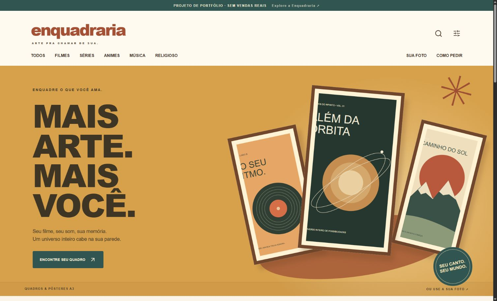

# Enquadraria

Uma galeria interativa de quadros e pôsteres A3 criada como **projeto de portfólio**. Não há vendas, cobrança, produção ou entrega de produtos.

**[Ver demonstração](https://enquadraria.vercel.app/)**



## O que funciona

- Galeria de modelos ilustrativos nas categorias Filmes, Séries, Animes, Música e Religioso.
- Busca de títulos e pôsteres de filmes, séries e animes pela API do TMDB, com visualização da imagem escolhida em um quadro.
- Prévia de quadro completo ou pôster A3, com tamanho e características.
- Interface para escolher uma foto própria.

O fluxo de pedidos de demonstração e o painel administrativo estão implementados na aplicação, mas permanecem desativados na versão pública até a configuração de um banco de dados separado. Os preços são exibidos como “sob consulta”; os valores de custo não são preços de venda.

## Tecnologias

Next.js 16, React 19, TypeScript, Vercel e TMDB. O esquema preparado para os pedidos e imagens está em [`enquadraria/supabase/schema.sql`](enquadraria/supabase/schema.sql).

## Executar localmente

```bash
cd enquadraria
pnpm install
pnpm dev
```

O site abre em `http://127.0.0.1:3000`. Para ativar a busca local, copie `enquadraria/.env.example` para `.env.local` e defina `TMDB_READ_ACCESS_TOKEN` com o token de leitura da sua conta TMDB. O token é usado apenas nas rotas do servidor. Nunca publique `.env.local` ou credenciais.

Na Vercel, configure a **Root Directory** como `enquadraria` caso conecte este repositório para novos deploys automáticos.

## Créditos

Este projeto usa a API e os pôsteres do [TMDB](https://www.themoviedb.org/). This product uses the TMDB API but is not endorsed or certified by TMDB. O logo oficial e o aviso aparecem no site; os direitos das imagens pertencem a seus respectivos titulares.
